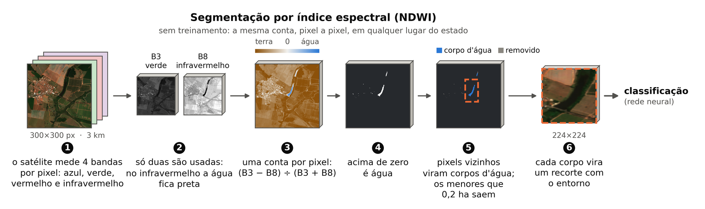
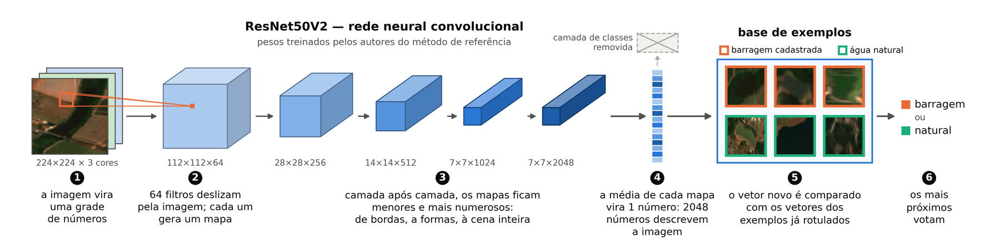
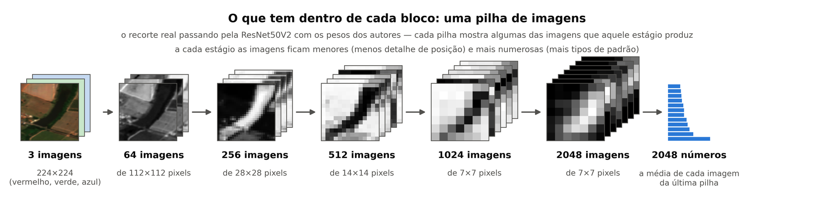

# Detecção de barragens não cadastradas por imagem de satélite

Iniciação Científica (PIBIC/CNPq) · Faculdade de Computação, Universidade Federal de Uberlândia
Autor: **Breno Prado Salgado Resende** · Orientador: Prof. Dr. Bruno Augusto Nassif Travençolo
Apresentado no XX Workshop de Teses e Dissertações em Ciência da Computação (WTDCC 2026)

📄 **[Pôster (PDF)](poster.pdf)** · [versão no Google Drive](https://drive.google.com/file/d/1-7LEvnaER3npLsOSZdookK61fftSQqEz/view?usp=sharing)
🎥 **[Vídeo de apresentação](https://youtu.be/npsa28Js2rA)**

> *English summary below.*

---

## O problema

No Brasil, uma barragem entra no cadastro oficial (SNISB/ANA) quando o proprietário declara a sua existência. A fiscalização presencial, que poderia encontrar as não declaradas, é cara e lenta para um território como Minas Gerais, com 586 mil km² e 2.212 barragens cadastradas. Ninguém sabe quantas ficaram de fora — e uma barragem desconhecida é uma barragem cujo risco não é avaliado.

A pergunta da pesquisa: **imagens de satélite públicas permitem localizar automaticamente os reservatórios ausentes do cadastro?**

## O método

O ponto de partida é um método publicado no *IEEE Transactions on Geoscience and Remote Sensing* (van Soesbergen et al., 2022), em duas etapas: **segmentar** a água e **classificar** cada corpo d'água como reservatório de barragem ou corpo natural. O método foi reproduzido e validado nos dados originais dos autores antes de ser aplicado a Minas Gerais.

### 1. Segmentação: infravermelho no lugar da rede

A rede de segmentação publicada falhou nas imagens brasileiras: treinada em outro domínio, ela marcava os alvos mais claros da cena, enquanto a água em Minas é o elemento mais escuro. Foi substituída pelo **NDWI**, um índice espectral que usa o infravermelho próximo — faixa em que a água absorve quase toda a radiação e a vegetação reflete intensamente.

```
NDWI = (B3 − B8) / (B3 + B8)      verde e infravermelho próximo do Sentinel-2
```

Não exige treinamento, funciona do mesmo jeito em qualquer região e é cerca de 60 vezes mais rápido que a rede original.



### 2. Classificação: rede convolucional com aprendizado de métrica

Cada corpo d'água encontrado é recortado com o seu entorno e passa por uma **ResNet50V2**, que o transforma em um vetor de 2048 números. A rede foi treinada pelos autores com *triplet loss*, que aproxima os vetores de imagens da mesma classe — por isso a classe é decidida comparando o vetor novo com os de exemplos já rotulados.

Neste trabalho a rede foi mantida e a **base de exemplos foi refeita com 1.817 recortes brasileiros** extraídos do cadastro da ANA, sem retreinar nenhum peso. O ajuste fino com dados nacionais é a próxima etapa.



O que acontece com o recorte dentro da rede — cada estágio produz uma pilha de imagens menores e mais numerosas:



### 3. Sistema

Um *pipeline* em lote varre o estado inteiro, cruza cada detecção com o cadastro oficial e alimenta uma aplicação web para análise de regiões sob demanda e curadoria manual das detecções.

## Resultados

- Varredura de **12,2 gigapixels** de imagem Sentinel-2 cobrindo Minas Gerais, processada em computador pessoal, com imagens gratuitas.
- Após curadoria parcial, **18.637 corpos d'água candidatos fora do cadastro**, além de **1.419 detecções que coincidem** com barragens já cadastradas.
- O principal erro remanescente é trecho de rio estreito confundido com açude: a 10 m por pixel os dois têm a mesma assinatura espectral. Imagens de resolução maior com infravermelho devem resolver isso sem mudança de método.

## Ferramentas

Python · TensorFlow / Keras · scikit-learn · NumPy · OpenCV · scikit-image · rasterio · Google Earth Engine · Sentinel-2 · Flask · React · Leaflet

## Próximos passos

1. Ajuste fino da rede com dados brasileiros, para dispensar a curadoria manual.
2. Imagens de resolução superior, para eliminar a confusão entre rio e açude.
3. Acoplamento a um modelo de risco, para transformar a lista de detecções em fila de prioridade para a fiscalização.

## Referências

- VAN SOESBERGEN, A.; CHU, Z.; SHI, M.; MULLIGAN, M. Dam Reservoir Extraction From Remote Sensing Imagery Using Tailored Metric Learning Strategies. *IEEE Transactions on Geoscience and Remote Sensing*, v. 60, p. 1-14, 2022.
- McFEETERS, S. K. The use of the Normalized Difference Water Index (NDWI) in the delineation of open water features. *International Journal of Remote Sensing*, v. 17, n. 7, p. 1425-1432, 1996.

O código-fonte da pesquisa não é público neste repositório.

## Agradecimentos

Ao CNPq, pela bolsa de iniciação científica (PIBIC/CNPq), e à Universidade Federal de Uberlândia, pelo suporte à pesquisa.

---

## English summary

**Detecting unregistered dams from satellite imagery** — undergraduate research (PIBIC/CNPq), Federal University of Uberlândia, Brazil.

Brazil's dam registry relies on owners declaring their dams, leaving an unknown number unregistered. This project adapts a published deep learning method (van Soesbergen et al., *IEEE TGRS*, 2022) to the Brazilian state of Minas Gerais. The published segmentation network failed under domain shift and was replaced by a near-infrared spectral index (NDWI), which is training-free and ~60× faster. Water bodies are classified by the authors' ResNet50V2 metric-learning model, whose reference set was rebuilt with 1,817 Brazilian samples from the national registry, without retraining. A statewide pipeline processed 12.2 gigapixels of Sentinel-2 imagery on a personal computer and cross-referenced every detection against the official registry, feeding a web application (Flask, React, Leaflet) for analysis and manual curation.
